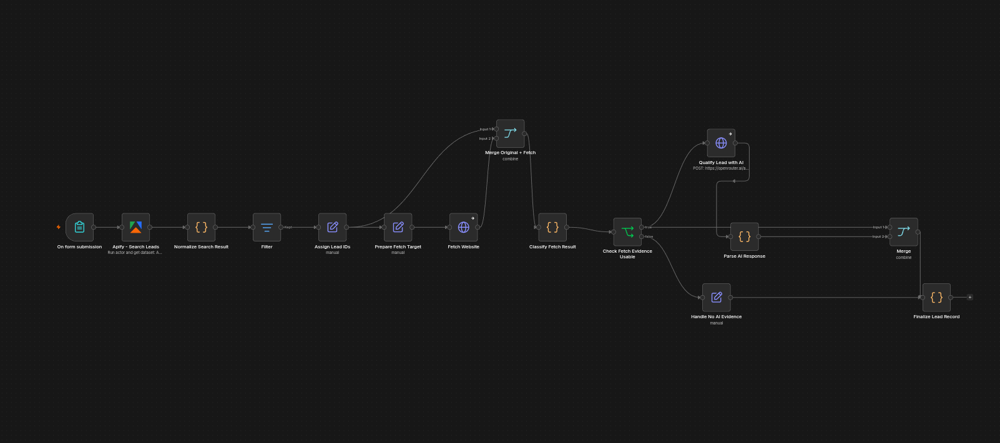

# AI Sales Lead Qualification

An n8n automation workflow that discovers potential real estate leads, fetches company websites, and uses AI to assess whether each company may be a suitable sales prospect.

## Overview

This project demonstrates how workflow automation, web data collection, and large language models can work together to streamline an initial lead qualification process.

## Workflow



1. **Search for leads** using Apify.
2. **Normalize and filter** the search results.
3. **Fetch company websites** to gather additional evidence.
4. **Qualify leads with AI** using an OpenRouter-hosted language model.
5. **Parse and finalize results**, including handling cases where usable website evidence is unavailable.

## Example Output

A sanitized example of the workflow's actual output is available in [`examples/sample-output.json`](examples/sample-output.json).

The example demonstrates successful website retrieval, AI-based lead classification, a qualification score, and generated reasoning.

**Important:** A successful execution does not guarantee a correct qualification. In this example, the source page was a comparison article, yet the AI returned `qualified` with a score of 85. This illustrates why production systems should validate source-page type and distinguish direct company websites from third-party articles and directories.


## Technology Stack

- **n8n** — workflow orchestration
- **Apify** — lead discovery and search results
- **OpenRouter** — access to the AI model
- **Docker** — local deployment environment

## Repository Structure

```text
.
├── workflow/
│   ├── public/
│   │   └── ai-sales-lead-qualification.json
│   └── ai-sales-lead-qualification.json
├── docs/
│   └── images/
├── examples/
├── README.md
└── .gitignore
```

The original workflow export is retained locally for development. Review it before publishing; only commit files intended for public sharing.

## Requirements

- Docker Desktop or Docker Engine
- A running n8n instance
- Apify credentials
- OpenRouter credentials

## Import and Run Locally

1. Open your local n8n instance.
2. Import `workflow/public/ai-sales-lead-qualification.json`.
3. Configure the required Apify and OpenRouter credentials in n8n.
4. Review the workflow configuration before executing it.
5. Run the workflow manually and inspect the output.

The exported workflow does not include your actual API credentials. You must configure your own credentials in n8n.

## Current Limitations

- AI qualification is an initial screening aid, not a guarantee that a lead is a genuine buyer.
- Search results and website content may be incomplete or misleading.
- Lead quality depends on the search query, available website evidence, and model output.
- Additional validation and evaluation are needed before using this workflow for production sales operations.

## Security

- Never commit API keys, passwords, credential exports, or private n8n backups.
- Keep local backup archives out of the public repository.
- Review workflow exports and sample data before publishing.

## Status

Portfolio project — local Docker-based demonstration.
